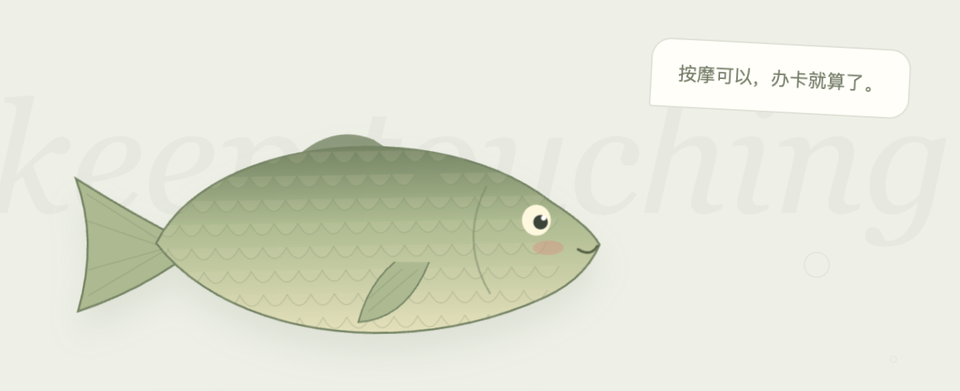

# 🐟 摸鱼办事处

**你摸了 49 下，葱姜都切好了。同事路过摸了一下，把鱼放了。**

把链接丢进群，大家就围上了同一条鱼。谁抢到第 50 下，谁决定红烧、清蒸、剁椒，还是让它活着下班。

**[进鱼塘，摸一下 →](https://aria-cats.github.io/moyu-office/)**　手机、电脑都能玩，免注册。

[](https://aria-cats.github.io/moyu-office/)

试试一口气连摸十下。鱼大福会当场翻身，屏幕上还会跳出「鱼已申请工伤」。

听见老板的脚步声？按一下 `Esc`，鱼塘就变成《2026 年 Q4 项目推进与执行进度表》。再按一下，回来看看鱼还在不在。

鱼塘里已经有一条叫「鲑薪很高」的三文鱼了。下一位鱼同事叫什么？[给鱼起个名 ↗](https://github.com/Aria-cats/moyu-office/issues/new)

<details>
<summary>自己开一间摸鱼办事处 · 本地运行与部署</summary>

在线鱼塘由 GitHub Pages 和腾讯云 CloudBase 运行，每轮 50 下。下面是本仓库 Python / SQLite 版本的搭建方法。想在本机也玩 50 下，启动时使用 `MOYU_TARGET=50 python3 server.py`。

## 本地运行

需要 Python 3.9 或以上版本：

```sh
git clone https://github.com/Aria-cats/moyu-office.git
cd moyu-office
python3 server.py
```

打开 <http://localhost:8765>。同一局域网可用 `http://服务器IP:8765` 访问。

**所有玩家访问同一套鱼塘服务，才能共摸同一条鱼。** GitHub 仓库只托管源代码。没有服务器时会提示连接失败并暂停点击，不会生成单人游戏。

## 服务器接口

连接入口已独立放在 `config.js`，默认 `apiBaseUrl: "/api"`。状态读取、摸鱼、选做法、下一轮四个方法集中在 `api.js`。同域部署直接可用，单独服务器或替换后端请看 [API.md](API.md)。

## 最省事的多人托管：Render

仓库包含 `render.yaml`，配置一个 Python Web Service 和 1GB 持久化磁盘。付费部署，具体价格以 Render 下单页面为准。

[](https://render.com/deploy?repo=https://github.com/Aria-cats/moyu-office)

1. 登录 Render，点击上面的部署按钮，授权读取此仓库。
2. 检查套餐、区域与账单；模板默认 Starter、新加坡、单实例、1GB 磁盘。
3. 确认创建。平台会提供带 HTTPS 的 `onrender.com` 地址。
4. 把同一个地址分享给朋友。首次连接即分配匿名身份，无需注册游戏账号。

SQLite 数据位于 `/var/data/moyu.sqlite3`，必须保留持久化磁盘。不要将此实例改成免费临时磁盘服务，也不要横向扩容多个独立实例，否则数据可能丢失或出现多个鱼塘。

## 自己的服务器：Docker

开发或局域网运行：

```sh
docker compose up -d --build
```

正式部署到有公网 IP 的 Linux 服务器，并让域名 DNS 指向它：

```sh
cp .env.example .env
# 编辑 .env，将 DOMAIN 改为你的实际域名
docker compose -f compose.production.yaml up -d --build
```

放行 80/443 端口。Caddy 自动申请 HTTPS 证书并反向代理到鱼塘；数据库位于独立 Docker volume。不要使用 `docker compose down -v` 删除数据卷。通过 SQLite 备份 API 制作一致性备份，恢复前先停服务；不要仅复制正在写入的主数据库文件而遗漏 WAL。

## 配置

| 环境变量 | 默认 | 含义 |
| --- | --- | --- |
| `PORT` | `8765` | 监听端口 |
| `MOYU_DB` | 项目目录 `moyu.sqlite3` | 数据库路径 |
| `MOYU_TARGET` | `10000` | 新建轮次的目标次数 |
| `MOYU_CHOICE_SECONDS` | `180` | 最后一摸的选择期限 |
| `MOYU_RATE` | `8` | 每个匿名会话每秒恢复的点击额度，最大瞬时额度 12 |
| `MOYU_SECURE_COOKIE` | 未启用 | HTTPS 部署设为 `1` |
| `MOYU_ALLOWED_ORIGINS` | 空 | 可选，允许的前端来源，英文逗号分隔；默认同域 |

## 玩法与实现边界

匿名身份保存在 HttpOnly、SameSite Cookie 中。清除 Cookie 或换浏览器会变成新玩家；领取最终决定权请使用原浏览器。断线后保留 Cookie 即可回来继续决定。

SQLite 事务确保计数不超标和最终决定权唯一。同一次点击的网络重试通过事件编号去重。服务端不会向其他玩家暴露最终玩家的身份凭证。基本会话限流用于控制手误或普通连点；这是轻量休闲应用，并未实现账号体系、机器人识别或分布式防刷。推荐先以小范围朋友试玩验证实际容量；公开流量扩大后再迁移数据库和增加网关限流。

页面每 1.3 秒同步一次共享状态；最后一摸、超时放生和下一轮都由服务端判定。点击「下一条鱼」会开启公共新一轮，旧轮记录保留在档案中。

## 验证

```sh
python3 -m unittest discover -s tests -v
node --check app.js
node --test tests/test_api.mjs
```

自动检查覆盖：32 个独立客户端争抢最后一摸、网络重试不重复计数、权限隔离、选择超时自动放生、同时开启下一轮、过期点击、持久化、旧数据库迁移、异常请求、数据文件隔离及限流。GitHub Actions 在推送和 PR 时运行。

浏览器验证覆盖多人同步、老板模式、输入草稿恢复、后台结算隔离、焦点及手机返回按钮。安装 Browser Use 后，在仓库目录运行 `browser-use < tests/check_boss.browser.py`；脚本自动启动临时服务器和数据库、用小目标跑完整多人流程并清理，不操作正式鱼塘。

接口测试还覆盖配置化地址、Cookie 携带、四种操作、断线不生成假进度、响应校验、超时及 CORS 来源白名单。部署模板已提供；正式上线后仍需验证目标平台网络、磁盘和 HTTPS。

</details>

项目采用 MIT 许可证。角色数据在 `app.js` 的 `fishes` 中，插画由项目内的 SVG 绘制。视觉参考 Kimi 灵感库的留白与卡片布局。
